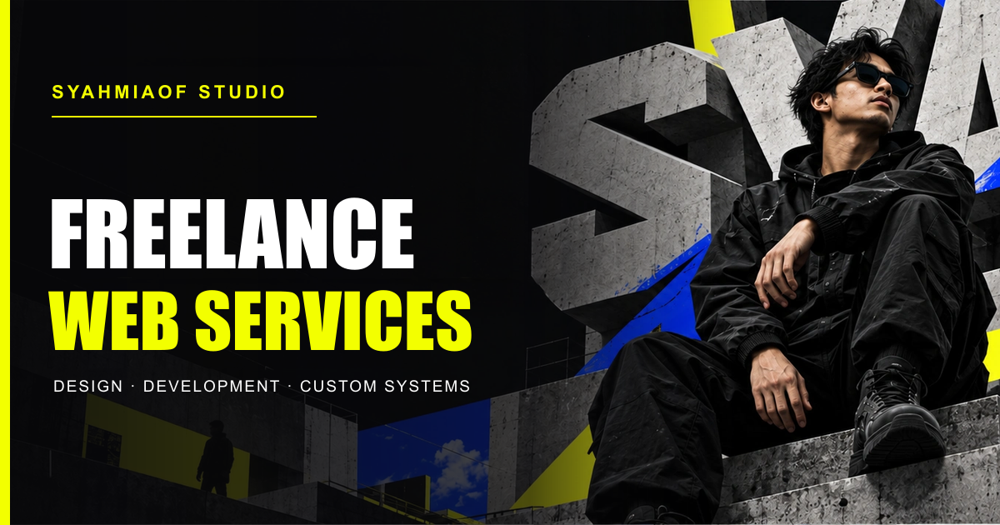

<div align="center">
  <h1>studioweb.syahmiaof.my</h1>
  <p><strong>SYAHMIAOF STUDIO — Digital Brutalism Web Development & 1:1 Coaching Experience</strong></p>
  <p>
    <a href="https://studioweb.syahmiaof.my"></a>
    <a href="https://github.com/syahmiaof/studioweb.syahmiaof.my"></a>
    <a href="https://github.com/syahmiaof/studioweb.syahmiaof.my/actions"></a>
    <a href="LICENSE"></a>
  </p>
  <p>
    
    
    
    
    
    
  </p>
</div>

---

<div align="center">
  
</div>

---

## 🌟 Overview & Commercial Value

**SYAHMIAOF STUDIO** (`studioweb.syahmiaof.my`) is a high-performance digital agency web platform engineered with an unapologetic **Digital Brutalism** design aesthetic. It blends heavy-duty industrial typography, high-contrast monochrome tones, and precision neon accents with smooth hardware-accelerated animations to showcase bespoke web engineering and 1:1 coaching services.

### Key Value Pillars:
- **Functionality**: Complete 7-route bilingual experience (`ms` & `en`) featuring deterministic pricing calculation, interactive package configuration, URL state preservation, and zero-compromise form validation.
- **Aesthetic Excellence**: High-density typography, layered 2D transparent character cutouts, bespoke noise textures, and cinematic scroll choreography powered by GSAP.
- **Business Impact**: Provides clear commercial conversion paths for enterprise clients, agencies, and individual developers seeking specialized web architecture and mentoring.

---

## 🏗️ Architecture & Technical Layout

```text
studio.syahmiaof.my/
  docs/
    engineering/                       # Authoritative functional specification & blueprints
    design/                            # Asset provenance, visual contracts & references
    qa/                                # Visual audit reports, comparison logs, and matrices
  public/
    assets/                            # Alpha WebP derivatives, cutouts, and visual assets
    opengraph-image.png                # High-resolution social metadata & showcase banner
  src/
    app/                               # Next.js 14 App Router routes (Bilingual: BM & EN)
      api/inquiries/route.ts           # Zod-validated inquiry Route Handler
      page.tsx                         # Route 01: Home
      servis/page.tsx                  # Route 02: Services
      portfolio/page.tsx               # Route 03: Portfolio
      harga/page.tsx                   # Route 04: Pricing Engine
      coaching/page.tsx                # Route 05: 1:1 Coaching
      tentang/page.tsx                 # Route 06: About
      hubungi/page.tsx                 # Route 07: Contact & Inquiries
      en/                              # Full English mirror routes
    components/
      layout/                          # Bilingual responsive Header & Footer
      scene/                           # Scoped GSAP scene primitives & brand visual layer
      pages/                           # Route-specific view components
    content/                           # Structured TypeScript content models
    i18n/                              # Bilingual dictionary engine
    lib/
      pricing/                         # Deterministic pricing engine & add-on arithmetic
      validation/                      # Zod inquiry schema with honeypot security
```

---

## 💎 Commercial & Integrity Standards

1. **Deterministic Pricing Engine:** Transparent, deterministic arithmetic across all service tiers (Landing Page, Business Website, Custom Web Platform, Add-on modules).
2. **State-Preserving URL Handoff:** Seamless parameter propagation when transitioning between pricing calculators, coaching selection, and contact flows across bilingual routes.
3. **Transparent Brand Mascot:** Dedicated techwear visual character engineered as a distinct 2D brand mascot representing modern digital craftsmanship.
4. **Honest Inquiry Gateway:** Graceful fallback handoffs ensuring zero message loss through verified email app protocols.

---

## 📄 License & Intellectual Property

Proprietary Software. Copyright &copy; 2026 Muhammad Syahmi (`syahmiaof`). All rights reserved.  
Unauthorized distribution, copying, modification, or commercial exploitation is strictly prohibited. See [LICENSE](LICENSE) for full legal terms.
